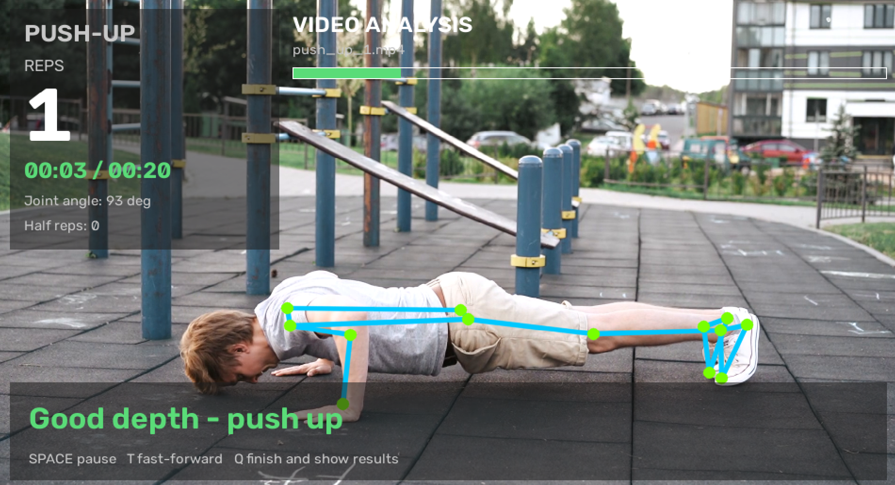
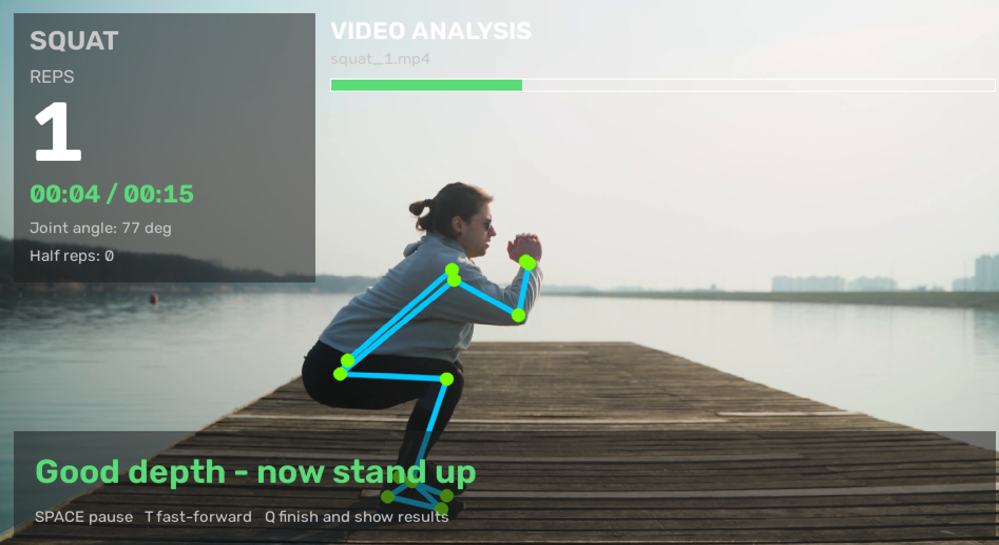

# AI Pose Trainer
 
A small computer-vision demo for a Physical Education course. It uses MediaPipe Pose to
track the body, draw a skeleton, count repetitions of **squats** and **push-ups**, and give
simple posture feedback. It works live with a webcam and on **recorded videos**, supports
**30 s / 60 s timed tests**, and keeps a **progress history for each person**.
 
> Educational demonstration only. The feedback is simple rule-based geometry and is
> **not** a medical or injury assessment.


## Preview

<div align="center">
  <div style="display: flex; justify-content: center; gap: 20px; flex-wrap: wrap;">
    <div style="width: 48%; min-width: 300px;">
      <h3>Push-up Analysis</h3>
      
      
    </div>
    <div style="width: 48%; min-width: 300px;">
      <h3>Squat Analysis</h3>
      
      
    </div>
  </div>
</div>

## Features
 
- Real-time skeleton overlay on the webcam feed
- Squat and push-up repetition counting with rule-based feedback
  ("Go lower", "Keep your chest up", "Keep your body aligned", ...)
- **Modes for each exercise:** Free practice, **30 s** test, **60 s** test (countdown timer)
- **Profiles:** create a profile per person; every finished workout is saved to it
- **Progress screen:** statistics and a chart of reps over time, personal bests
- **Video analysis:** analyze a recorded video and see detailed results
- Results screen after every session (full reps, half reps, form, timing, depth chart)
- Clickable buttons and keyboard shortcuts, 3-second countdown, beep on every rep, fullscreen
- Runs locally on CPU, offline after the first start. No cloud, no database.
## Installation (Windows 10, Python 3.12)
 
```
py -3.12 -m venv venv
venv\Scripts\activate
python -m pip install --upgrade pip
pip install -r requirements.txt
```
 
## Run
 
Live webcam:
 
```
python app.py
```
 
Analyze a recorded video without a webcam:
 
```
python app.py --video C:\videos\my_squats.mp4 --exercise squat
python app.py --video C:\videos\my_pushups.mp4 --exercise push-up --profile Ali
```
 
On the first run the app downloads the pose model (~5 MB) into the `models/` folder.
After that it works fully offline. If the download fails, the error message shows
the URL and where to save the file manually.
 
If the wrong camera opens, try `python app.py --camera 1`.
 
## Quick start for a demonstration
 
1. Click **Profile** (or press `P`), choose **New...** and type a name. A new profile becomes the active one.
2. Select **Squat** or **Push-up**, and a mode: **Free**, **30 s** or **60 s**.
3. Click **Start** (or press SPACE). After a 3-second countdown the session begins.
4. In a timed mode the session ends by itself at 0:00. In Free mode press **Stop**.
5. The results screen appears and the workout is saved to the profile. Press `S` to save the screen as an image, ENTER to continue.
6. Click **Progress** (or press `H`) to see the history, personal best and chart.
## Controls
 
| Key | Mouse button | Action |
|---|---|---|
| SPACE | Start / Stop | Start a session / end it and show the results |
| R | Reset | Discard the current session (nothing is saved) and clear the counter |
| 1 / 2 | Squat / Push-up | Select the exercise |
| T | Free / 30 s / 60 s | Change mode (the key cycles Free, 30 s, 60 s) |
| P | Profile button | Select, create or delete profiles |
| H | Progress | Progress history of the selected profile |
| O | Video | Choose a recorded video and analyze it with the selected exercise |
| F | - | Fullscreen on/off |
| M | - | Sound on/off |
| Q / ESC | - | Quit |
 
The exercise, mode, profile and video buttons are locked while a session is running
("Stop the session first").
 
## Modes
 
| Mode | What happens |
|---|---|
| Free | Practice with no time limit. Press Stop to finish. |
| 30 s / 60 s | After the countdown a timer counts down. The session ends automatically at 0:00. Only reps completed before the time ran out are counted. A movement still in progress at the end is stored as an unfinished (half) rep. |
 
Personal bests are compared per exercise **and** mode (for example your best 30 s squat
test). The results screen shows **NEW PERSONAL BEST!** when you beat your previous best.
 
## Profiles and saved data
 
- Profiles and workout records are stored in one file: `data/profiles.json` (created automatically).
  Result images saved with `S` go to `data/results/`.
- Each record contains: date and time, exercise, mode, duration, reps, half reps, good-form
  reps, form warnings, average rep time and depth, and whether it came from the live camera or a video.
- Video analyses are saved to the selected profile too (mode "Free", source "video").
  If no profile is selected, the results screen says "not saved".
- Sessions with no repetitions are not saved (except a completed timed test).
- Deleting a profile deletes all of its workouts. To back up or move your data, copy the `data` folder.
- Profile names can have at most 20 characters. The on-screen text only supports English
  characters, so use English names (other characters are shown as "?").
## Progress screen
 
Shows, for one exercise and mode (press `E` to change the exercise and `M` to change the mode filter):
 
- number of workouts, total reps, personal best (with date), average reps per workout
- first -> latest workout (is the person improving?)
- average time per rep, average depth, percentage of reps with good form
- the last four sessions
- a chart of reps per workout (latest 20), with the personal best highlighted
## Video analysis
 
1. Select **Squat** or **Push-up**, click **Video** (or press `O`) and choose a file
   (or use the `--video` command-line option).
2. The video plays at normal speed with the skeleton and a live rep counter.
   SPACE pauses, T toggles fast-forward, Q / ESC stops early and shows the results.
3. The results screen appears at the end.
### What the results screen shows
 
| Item | Meaning |
|---|---|
| Full reps counted | Reps that reached full depth and returned to the top |
| Half reps (not counted) | Clear attempts that went down but did not reach full depth, plus a movement still unfinished at the end |
| Rep completion rate | Full reps divided by all attempts (full + half) |
| Reps with good form / form warnings | Full reps where no warning ("Keep your chest up" / "Keep your body aligned") appeared during the rep |
| Session / video length, reps per minute | Reps per minute is measured over the whole session or video |
| Average / fastest / slowest rep time | Time from starting to go down until back at the top |
| Average / deepest depth | Smallest joint angle reached per rep (smaller = deeper) |
| Body tracked in | Share of frames where a person was detected (a quality check) |
| Chart | One bar per attempt: green = full rep, yellow = full rep with form warning, red = half rep. The dashed line is the depth needed for a full rep |
 
Tiny wobbles (a very small knee or elbow bend) are ignored and are not counted as half reps.
 
### Tips for recording a video
 
- Same camera tips as live mode: side view, whole body in frame, even lighting.
- Keep the camera still (a phone on a stand or a stack of books works well).
- Use `.mp4` (H.264). Phone videos in portrait or landscape both work.
- If the video does not open and its path contains non-English characters, copy it to a
  simple path such as `C:\videos\test.mp4`.
## How to do a squat
 

 
## How to do a push-up
 

 
## How the counting works
 
Each exercise uses one joint angle that is smoothed and run through a small state machine.
A repetition counts when you reach the bottom position and return to the top.
 
| Exercise | Joint angle | Bottom | Top | Extra feedback |
|---|---|---|---|---|
| Squat | knee (hip-knee-ankle) | below 100 deg | above 160 deg | torso lean ("Keep your chest up") |
| Push-up | elbow (shoulder-elbow-wrist) | below 95 deg | above 155 deg | body line shoulder-hip-ankle ("Keep your body aligned") |
 
Push-ups are only counted while the body is roughly horizontal, so standing up or walking
around never adds repetitions.
 
## Camera setup tips
 
- **Squats:** stand sideways (or at about 45 degrees) to the camera with hips, knees and ankles visible.
- **Push-ups:** place the camera at floor level, about 2-3 m away, and lie sideways to it so the whole body is in frame.
- Keep your whole body in the picture, use even lighting, and avoid strong backlight (a window behind you).
- Wear clothes that contrast with the background.
## Known limitations
 
- Accuracy drops when facing the camera directly (squats) or when limbs are hidden.
- Only one person is tracked.
- Very fast movements can cause missed counts.
- The body-alignment check cannot tell a sagging hip from a raised hip; it only reports "Keep your body aligned".
- Thresholds are fixed and may need adjusting for different people or camera angles.
- Half-rep and form statistics depend on the same rough thresholds, so treat them as indicators, not exact measurements.
- Progress comparisons between sessions are only meaningful if the camera position and distance are similar.
- Records are stored on this computer only. Nothing identifies a person except the name typed in.
- On-screen text supports English characters only.
## Project structure
 
```
app.py              OpenCV window, buttons, HUD, live loop, sessions and modes
pose_estimator.py   MediaPipe PoseLandmarker wrapper + skeleton drawing
exercises.py        Angle math, squat and push-up state machines, feedback, rep statistics
profiles.py         Profile storage (data/profiles.json) and workout records
profile_dialog.py   Window to select, create and delete profiles
progress_screen.py  Progress history screen (statistics + chart)
results_screen.py   Results screen after a session or video
video_analyzer.py   Plays and analyzes a recorded video, file picker
ui.py               Shared drawing helpers
requirements.txt
images/             squat.svg, pushup.svg (illustrations used in this README)
data/               created at runtime: profiles.json, results/ (ignored by Git)
```
 
## Credits
 
- MediaPipe Pose Landmarker (Google, Apache 2.0)
- OpenCV

## License
See [License](./LICENSE).