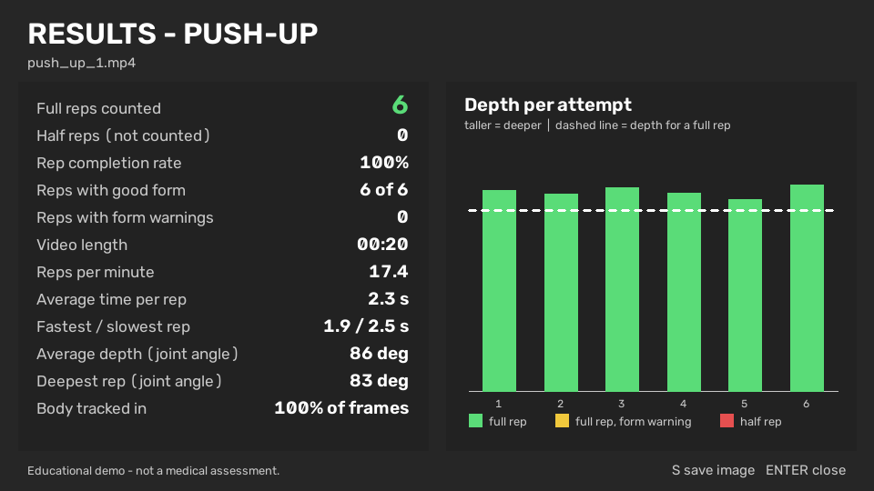
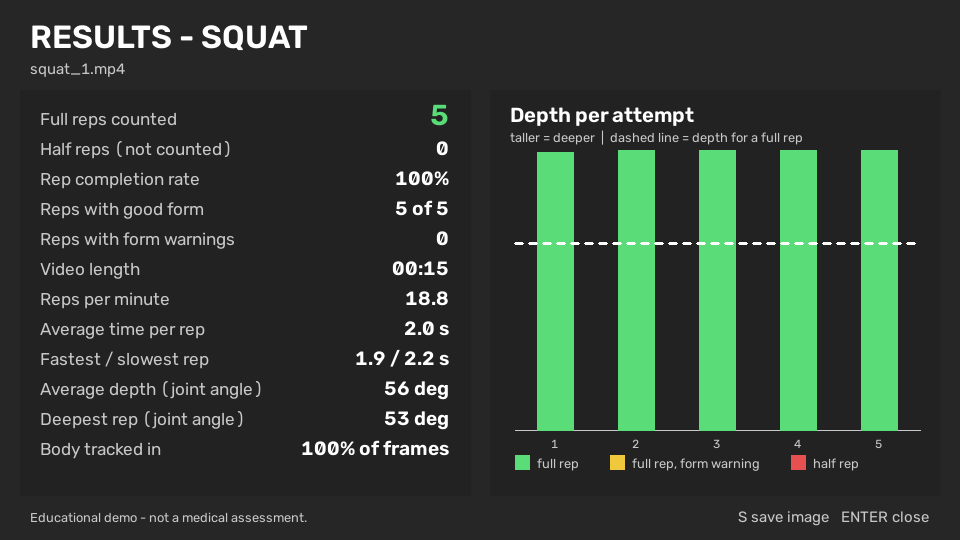
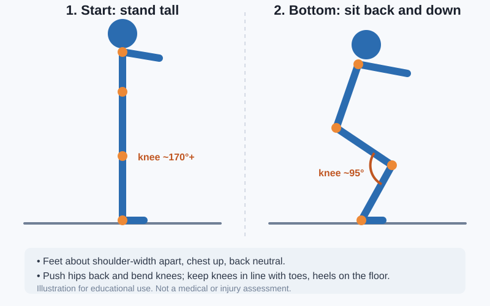
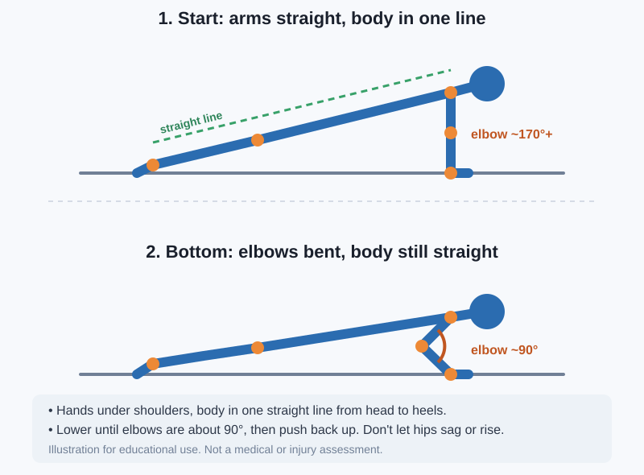

# AI Pose Trainer

A small computer-vision demo for a Physical Education course. It uses MediaPipe Pose to
track the body, draw a skeleton, count repetitions of **squats** and **push-ups**, and give
simple posture feedback. It works live with a webcam and on **recorded videos**, offers
**30 s / 60 s timed tests**, and keeps a **progress history for each person**.

> Educational demonstration only. The feedback is simple rule-based geometry and is
> **not** a medical or injury assessment.

🌐 **Live web app (laptop and phone): [https://amirmasoudcs.github.io/ai-pose-trainer/](https://amirmasoudcs.github.io/ai-pose-trainer/)**

## Preview

<div align="center">
  <div style="display: flex; justify-content: center; gap: 20px; flex-wrap: wrap;">
    <div style="width: 48%; min-width: 300px;">
      <h3>Push-up Analysis</h3>
      
      
    </div>
    <div style="width: 48%; min-width: 300px;">
      <h3>Squat Analysis</h3>
      
      
    </div>
  </div>
</div>

## Features

- Real-time skeleton overlay, rep counting and rule-based feedback
  ("Go lower", "Keep your chest up", "Keep your body aligned", ...)
- **Modes:** Free practice, **30 s** test or **60 s** test (countdown timer)
- **Profiles:** one per person; every finished workout is saved automatically
- **Progress screen:** statistics, personal bests and a chart of reps over time
- **Video analysis:** analyze a recorded video and get detailed results
- **Results screen** after every session: full and half reps, form, timing, depth chart
- Clickable buttons and keyboard shortcuts, countdown, beep on each rep, fullscreen
- Runs locally on CPU, offline after the first start (no cloud, no database)

## Web app (phone and laptop)

**Open it here: [https://amirmasoudcs.github.io/ai-pose-trainer/](https://amirmasoudcs.github.io/ai-pose-trainer/)**

It is the same trainer as a **website that runs in the browser**, so it works on a phone too.
Pose detection happens on your own device (no backend, no upload), and it is hosted for free
with GitHub Pages. It currently offers the camera view, skeleton, squat and push-up counting
and feedback; timed modes, profiles and video analysis are coming.

1. Open the link in Chrome, Edge, Firefox or Safari (on a phone too).
2. Tap **Start camera** and allow camera access. The first visit downloads the pose model, so it needs internet.
3. Choose **Squat** or **Push-up**, prop the device up, and tap **Start**.

The source is in the `web/` folder; see [web/README.md](web/README.md) to run or publish your own copy.

## Installation (Windows 10, Python 3.12)

```
py -3.12 -m venv venv
venv\Scripts\activate
python -m pip install --upgrade pip
pip install -r requirements.txt
```

## Run

```
python main.py
```

Analyze a recorded video without a webcam (`--profile` is optional):

```
python main.py --video C:\videos\my_squats.mp4 --exercise squat
python main.py --video C:\videos\my_pushups.mp4 --exercise push-up --profile Ali
```

On the first run the app downloads the pose model (~5 MB) into `models/`; afterwards it
works offline. If the download fails, the error message shows the URL and where to save
the file manually. If the wrong camera opens, try `python main.py --camera 1`.

## Quick start

1. Click **Profile** (or press `P`) and choose **New...** to create a profile. It becomes the active one.
2. Select **Squat** or **Push-up**, then a mode: **Free**, **30 s** or **60 s**.
3. Click **Start** (or press SPACE). After a 3-second countdown the session begins.
4. Timed modes end by themselves at 0:00. In Free mode, press **Stop**.
5. The results screen appears and the workout is saved to the profile.
6. Click **Progress** (or press `H`) to see the history.

## Controls

| Key | Mouse button | Action |
|---|---|---|
| SPACE | Start / Stop | Start a session / end it and show the results |
| R | Reset | Discard the current session (nothing is saved) |
| 1 / 2 | Squat / Push-up | Select the exercise |
| T | Free / 30 s / 60 s | Change mode (the key cycles through them) |
| P | Profile | Select, create or delete profiles |
| H | Progress | Progress history of the selected profile |
| O | Video | Analyze a recorded video with the selected exercise |
| F / M | - | Fullscreen / sound on and off |
| Q / ESC | - | Quit |

Exercise, mode, profile and video buttons are locked while a session is running.

## Modes, profiles and progress

- **Timed modes:** only reps completed before 0:00 are counted. A movement still in
  progress at the end is stored as an unfinished (half) rep.
- **Personal bests** are compared per exercise **and** mode. The results screen shows
  **NEW PERSONAL BEST!** when you beat your previous best.
- **Saved data** lives in `data/profiles.json` (created automatically); images saved with
  `S` on a live session go to `data/results/`. Each record stores date, exercise, mode,
  duration, reps, half reps, form statistics, average rep time and depth, and whether it
  came from the camera or a video. To back up your data, copy the `data` folder.
- **Video analyses** are saved to the selected profile too (mode "Free", source "video").
  With no profile selected they are not saved. Sessions without any repetition are not saved.
- **Deleting a profile** deletes all of its workouts.
- **Progress screen:** workouts, total reps, personal best, first-to-latest change, average
  rep time, depth, share of reps with good form, the last four sessions and a chart.
  Press `E` to change the exercise and `M` to change the mode filter.
- Use English profile names (max. 20 characters): the on-screen font cannot draw other characters.

## Video analysis

1. Select an exercise, click **Video** (or press `O`) and choose a file.
2. The video plays with the skeleton and a live rep counter. SPACE pauses, `T` toggles
   fast-forward, Q / ESC stops early and shows the results.
3. On the results screen press `S` to save it as a PNG next to the video, ENTER to close.

### What the results screen shows

| Item | Meaning |
|---|---|
| Full reps counted | Reps that reached full depth and returned to the top |
| Half reps (not counted) | Clear attempts that did not reach full depth, plus a movement unfinished at the end |
| Rep completion rate | Full reps divided by all attempts |
| Good form / form warnings | Full reps without / with a warning ("Keep your chest up", "Keep your body aligned") |
| Reps per minute, rep times | Over the whole session or video; rep time = going down until back at the top |
| Average / deepest depth | Smallest joint angle reached per rep (smaller = deeper) |
| Body tracked in | Share of frames where a person was detected (quality check) |
| Chart | One bar per attempt: green = full rep, yellow = full rep with form warning, red = half rep; dashed line = depth needed for a full rep |

Tiny wobbles are ignored and are not counted as half reps.

## How to do a squat



## How to do a push-up



## How the counting works

Each exercise uses one smoothed joint angle and a small state machine. A repetition counts
when you reach the bottom position and return to the top.

| Exercise | Joint angle | Bottom | Top | Extra feedback |
|---|---|---|---|---|
| Squat | knee (hip-knee-ankle) | below 100 deg | above 160 deg | torso lean ("Keep your chest up") |
| Push-up | elbow (shoulder-elbow-wrist) | below 95 deg | above 155 deg | body line shoulder-hip-ankle ("Keep your body aligned") |

Push-ups are only counted while the body is roughly horizontal, so standing up or walking
around never adds repetitions.

## Camera and video tips

- **Squats:** stand sideways (or at about 45 degrees) with hips, knees and ankles visible.
- **Push-ups:** camera at floor level, 2-3 m away, lie sideways so the whole body is in frame.
- Keep the whole body in the picture, use even lighting, avoid backlight, wear contrasting clothes.
- Keep the camera still. For videos use `.mp4` (H.264); if a file does not open and its path
  contains non-English characters, copy it to a simple path such as `C:\videos\test.mp4`.
- Compare progress only between sessions with a similar camera position and distance.

## Known limitations

- Accuracy drops when facing the camera directly (squats) or when limbs are hidden.
- Only one person is tracked; very fast movements can cause missed counts.
- The alignment check cannot tell a sagging hip from a raised hip.
- Thresholds are fixed and may need adjusting for different people or camera angles.
  Half-rep and form statistics are indicators, not exact measurements.
- Records are stored on this computer only. On-screen text supports English characters only.

## Project structure

```txt
📁
├── 📁 .github/workflows         publishes the web app to GitHub Pages
│   └── 📄 pages.yml
├── 📁 assets
│   ├── 📁 images                    README illustrations and previews
│   │   ├── 📄 push_up_preview.png
│   │   ├── 📄 pushup.svg
│   │   ├── 📄 squat.svg
│   │   └── 📄 squat_preview.png
│   └── 📁 samples                   example videos and their results
│       ├── 🎬 push_up_1.mp4
│       ├── 🖼️ push_up_1_results.png
│       ├── 🎬 squat_1.mp4
│       └── 🖼️ squat_1_results.png
├── 📁 data                          created at runtime, ignored by Git
│   ├── 📁 results
│   └── 📄 profiles.json
├── 📁 models                        pose model, downloaded on first run
│   └── 📄 pose_landmarker_lite.task
├── 📁 pose_trainer                  the application package
│   ├── 📁 core                      pose detection and exercise logic
│   │   ├── 🐍 exercises.py          angles, squat / push-up rules, rep statistics
│   │   └── 🐍 pose_estimator.py     MediaPipe wrapper and skeleton drawing
│   ├── 📁 screens                   everything drawn on screen
│   │   ├── 🐍 draw.py               shared drawing helpers
│   │   ├── 🐍 profile_dialog.py     window to select, create and delete profiles
│   │   ├── 🐍 progress.py           progress history screen
│   │   └── 🐍 results.py            results screen after a session or video
│   ├── 📁 storage
│   │   └── 🐍 profiles.py           profile storage and workout records
│   ├── 🐍 app.py                    live loop, buttons, sessions and modes
│   ├── 🐍 paths.py                  project folders
│   └── 🐍 video_analyzer.py         recorded-video analysis and file picker
├── 📁 tests                         unit tests (no camera needed)
│   ├── 🐍 test_exercises.py
│   └── 🐍 test_profiles.py
├── 📁 web                           browser version (phone and laptop)
│   ├── 📁 css
│   │   └── 📄 style.css
│   ├── 📁 js
│   │   ├── 📄 draw.js               skeleton drawing
│   │   ├── 📄 exercises.js          counting logic (port of exercises.py)
│   │   ├── 📄 main.js               camera, main loop, display
│   │   └── 📄 pose.js               MediaPipe PoseLandmarker in the browser
│   ├── 📁 tests
│   │   └── 📄 exercises.test.mjs
│   ├── 📄 index.html
│   └── 📘 README.md
├── ⚖️ LICENSE
├── 🐍 main.py                       start the app: python main.py
├── 📘 README.md
└── 📝 requirements.txt
```
> Generated using [Tree Printer](https://github.com/AmirmasoudCS/Tree-Printer.git)

## Tests

The counting logic and the profile storage are tested with simulated body landmarks, so no
camera or MediaPipe is needed:

```
pip install pytest
python -m pytest
```

(The test files also run directly, e.g. `python tests/test_exercises.py`.)

## Credits

- MediaPipe Pose Landmarker (Google, Apache 2.0)
- OpenCV

## License
See [License](./LICENSE).