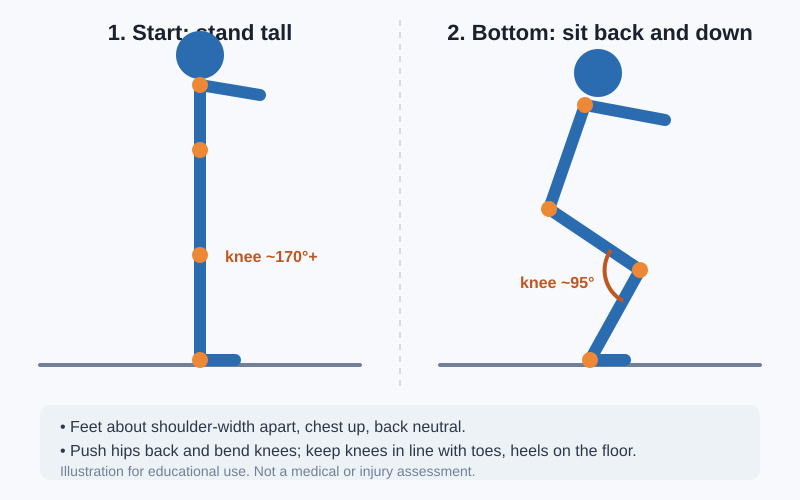

# AI Pose Trainer

A small computer-vision demo for a Physical Education course. It uses a webcam and
MediaPipe Pose to track the body, draw a skeleton, count repetitions of **squats** and
**push-ups**, and give simple posture feedback.

> Educational demonstration only. The feedback is simple rule-based geometry and is
> **not** a medical or injury assessment.

## Features

- Real-time skeleton overlay on the webcam feed
- Squat and push-up repetition counting
- Rule-based feedback ("Go lower", "Keep your chest up", "Keep your body aligned", ...)
- Clickable buttons (Squat, Push-up, Start/Stop, Reset) and keyboard shortcuts
- 3-second countdown after Start so you can get into position
- Session timer, separate counter per exercise
- Green flash and beep on every counted rep
- Fullscreen mode for presentations
- Runs locally on CPU, offline after the first start

## Installation (Windows 10, Python 3.12)

```
py -3.12 -m venv venv
venv\Scripts\activate
python -m pip install --upgrade pip
pip install -r requirements.txt
```

## Run

```
python app.py
```

On the first run the app downloads the pose model (~5 MB) into the `models/` folder.
After that it works fully offline. If the download fails, the error message shows
the URL and where to save the file manually.

If the wrong camera opens, try `python app.py --camera 1`.

## Controls

| Key | Mouse button | Action |
|---|---|---|
| SPACE | Start / Stop | Start or stop the session (3-second countdown on start) |
| R | Reset | Reset all counters and the timer |
| 1 / 2 | Squat / Push-up | Select the exercise |
| F | - | Fullscreen on/off |
| M | - | Sound on/off |
| Q / ESC | - | Quit |

## How to do a squat



## How to do a push-up


## How the counting works

Each exercise uses one joint angle that is smoothed and run through a small state machine.
A repetition counts when you reach the bottom position and return to the top. A shallow
movement is not counted and shows "Go lower".

| Exercise | Joint angle | Bottom | Top | Extra feedback |
|---|---|---|---|---|
| Squat | knee (hip-knee-ankle) | below 100 deg | above 160 deg | torso lean ("Keep your chest up") |
| Push-up | elbow (shoulder-elbow-wrist) | below 95 deg | above 155 deg | body line shoulder-hip-ankle ("Keep your body aligned") |

Push-ups are only counted while the body is roughly horizontal, so standing up or walking
around never adds repetitions.

## Camera setup tips

- **Squats:** stand sideways (or at about 45 degrees) to the camera with hips, knees and ankles visible.
- **Push-ups:** place the camera at floor level, about 2-3 m away, and lie sideways to it so the whole body is in frame.
- Keep your whole body in the picture, use even lighting, and avoid strong backlight (a window behind you).
- Wear clothes that contrast with the background.

## Known limitations

- Accuracy drops when facing the camera directly (squats) or when limbs are hidden.
- Only one person is tracked.
- Very fast movements can cause missed counts.
- The body-alignment check cannot tell a sagging hip from a raised hip; it only reports "Keep your body aligned".
- Thresholds are fixed and may need adjusting for different people or camera angles.

## Project structure

```
app.py              OpenCV window, buttons, HUD, keyboard/mouse controls
pose_estimator.py   MediaPipe PoseLandmarker wrapper + skeleton drawing
exercises.py        Angle math, squat and push-up state machines, feedback
requirements.txt
images/squat.svg    squat illustration used in this README
images/pushup.svg   push-up illustration used in this README
```

## Credits

- MediaPipe Pose Landmarker (Google, Apache 2.0)
- OpenCV